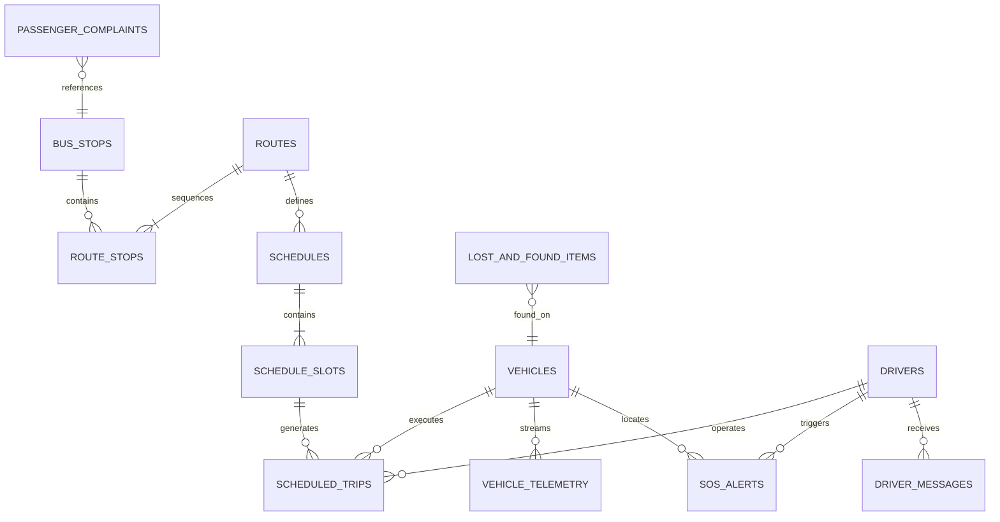

# CITYRIDE OCC Admin Portal — Backend Integration & Architecture Guide 🛠️

## 1. System Overview & Tech Stack

The **CITYRIDE OCC Admin Portal** is an Operations Control Center frontend for managing public bus transit in **Tumakuru, Karnataka**. It communicates with a **PostgreSQL / Supabase** backend via REST APIs and real-time WebSockets.

### Frontend Architecture
- **Framework**: React 18 with TypeScript & Vite
- **Styling**: Tailwind CSS & Lucide Icons
- **State Management**: Zustand (`useAuthStore`, `useLiveFleetStore`)
- **Data Fetching & Cache**: TanStack React Query v5
- **Mapping & Visuals**: Google Maps JavaScript API + Vector Radar Fallback
- **Data Visualization**: Recharts (Fleet Utilization, Daily Distance Span)
- **Form Handling & Validation**: React Hook Form + Zod

---

## 2. Role-Based Access Control (RBAC) Matrix

The system implements 6 administrative roles authenticated via Supabase Auth + `admin_users` table:

| Role Code | Role Name | Allowed Modules & Permissions |
| :--- | :--- | :--- |
| `SUPER_ADMIN` | Super Administrator | Full access to all modules, master data CRUD, safety dispatch, and analytics. |
| `OPERATIONS_MANAGER` | Operations Manager | Master data editing (Buses, Drivers, Routes, Schedules), Dispatch board, Incidents, and Analytics. |
| `DISPATCHER` | Transit Dispatcher | Live fleet tracking, Scheduled trips dispatching, Incident triage, SOS emergency desk, and Driver messaging. |
| `FLEET_MANAGER` | Fleet Manager | Vehicles registry, Maintenance status toggles, Driver allocations, and Fleet utilization analytics. |
| `SUPPORT_ADMIN` | Passenger Support Admin | Grievance & Complaints desk, Lost & Found custody ledger, and Push notification broadcasts. |
| `ANALYST` | Operations Analyst | Read-only access to Fleet & Routes performance analytics and Historical GPS breadcrumb replay. |

---

## 3. Database Schema & Entity Relationships



### Key Tables & Columns

1. **`admin_users`**
   - `id`: UUID (matches `auth.users.id`)
   - `full_name`: VARCHAR(100)
   - `email`: VARCHAR(255)
   - `role`: ENUM (`SUPER_ADMIN`, `OPERATIONS_MANAGER`, `DISPATCHER`, `FLEET_MANAGER`, `SUPPORT_ADMIN`, `ANALYST`)
   - `is_active`: BOOLEAN
   - `created_at`: TIMESTAMPTZ

2. **`vehicles`**
   - `id`: VARCHAR(50) (e.g. `CR_TUM_8558`)
   - `plate_number`: VARCHAR(20) (e.g. `KA 06 F 8558`)
   - `model`: VARCHAR(50) (e.g. `Tata Starbus EV / Ashok Leyland BS-VI`)
   - `propulsion_type`: ENUM (`ELECTRIC`, `DIESEL`, `CNG`)
   - `current_route_code`: VARCHAR(10) (e.g. `R01`)
   - `assigned_driver_id`: VARCHAR(50) (FK -> `drivers.id`)
   - `status`: ENUM (`active`, `maintenance`, `standby`, `retired`)
   - `created_at`: TIMESTAMPTZ

3. **`drivers`**
   - `id`: VARCHAR(50) (e.g. `DRV_1042`)
   - `full_name`: VARCHAR(100) (e.g. `Rajesh DRV-1042`)
   - `phone_number`: VARCHAR(15) (e.g. `+91 98450 11042`)
   - `license_number`: VARCHAR(50) (e.g. `KA06-2018-004521`)
   - `badge_number`: VARCHAR(30)
   - `duty_status`: ENUM (`on_duty`, `off_duty`, `on_break`, `suspended`)
   - `assigned_vehicle_id`: VARCHAR(50) (FK -> `vehicles.id`)
   - `assigned_route_code`: VARCHAR(10) (e.g. `R01`)
   - `created_at`: TIMESTAMPTZ

4. **`bus_stops`** (36 Stops in Tumakuru)
   - `id`: VARCHAR(50) (e.g. `STOP_001`)
   - `name`: VARCHAR(100) (e.g. `KSRTC Bus Stand`)
   - `latitude`: NUMERIC(10, 7) (e.g. `13.3395000`)
   - `longitude`: NUMERIC(10, 7) (e.g. `77.1005000`)
   - `is_terminal`: BOOLEAN
   - `has_shelter`: BOOLEAN
   - `is_active`: BOOLEAN

5. **`routes`** (8 Routes R01–R08)
   - `id`: VARCHAR(50) (e.g. `ROUTE_R01`)
   - `route_code`: VARCHAR(10) (e.g. `R01`)
   - `name`: VARCHAR(150) (e.g. `KSRTC Stand ↔ SIT Back Gate`)
   - `origin_stop_id`: VARCHAR(50) (FK -> `bus_stops.id`)
   - `destination_stop_id`: VARCHAR(50) (FK -> `bus_stops.id`)
   - `total_distance_km`: NUMERIC(5, 2)
   - `standard_travel_duration_minutes`: INT
   - `color_hex`: VARCHAR(10) (e.g. `#16a34a`)
   - `is_active`: BOOLEAN

6. **`route_stops`**
   - `route_id`: VARCHAR(50) (FK -> `routes.id`)
   - `stop_id`: VARCHAR(50) (FK -> `bus_stops.id`)
   - `stop_sequence`: INT (1, 2, 3...)
   - `distance_from_origin_km`: NUMERIC(5, 2)
   - `travel_time_minutes`: INT

7. **`schedules` & `schedule_slots`**
   - Timetable configurations defining departure times, frequencies, and assigned vehicle/driver templates.

8. **`scheduled_trips`**
   - `id`: VARCHAR(50)
   - `trip_number`: VARCHAR(50) (e.g. `TRIP-20260825-R01-01`)
   - `route_code`: VARCHAR(10)
   - `route_name`: VARCHAR(150)
   - `vehicle_plate`: VARCHAR(20)
   - `driver_name`: VARCHAR(100)
   - `scheduled_departure`: VARCHAR(10) (e.g. `06:30 AM`)
   - `scheduled_arrival`: VARCHAR(10) (e.g. `07:15 AM`)
   - `status`: ENUM (`scheduled`, `in_progress`, `completed`, `cancelled`, `delayed`)
   - `service_date`: DATE

9. **`sos_alerts`**
   - `id`: VARCHAR(50)
   - `vehicle_id`: VARCHAR(50)
   - `vehicle_plate`: VARCHAR(20)
   - `route_code`: VARCHAR(10)
   - `driver_name`: VARCHAR(100)
   - `driver_phone`: VARCHAR(20)
   - `type`: ENUM (`MEDICAL`, `ACCIDENT`, `SECURITY`, `FIRE`, `BREAKDOWN`)
   - `priority`: ENUM (`CRITICAL`, `HIGH`, `MEDIUM`)
   - `status`: ENUM (`TRIGGERED`, `ACKNOWLEDGED`, `HELP_DISPATCHED`, `RESOLVED`)
   - `latitude`: NUMERIC(10, 7)
   - `longitude`: NUMERIC(10, 7)
   - `location_name`: VARCHAR(150)
   - `passengers_onboard`: INT
   - `dispatched_services`: TEXT[]
   - `notes`: TEXT
   - `created_at`: TIMESTAMPTZ
   - `acknowledged_at`: TIMESTAMPTZ
   - `resolved_at`: TIMESTAMPTZ

10. **`incident_reports`**
    - `id`: VARCHAR(50)
    - `type`: ENUM (`ACCIDENT`, `BREAKDOWN`, `TRAFFIC_BLOCK`, `PASSENGER_MISBEHAVIOR`, `ROUTE_DEVIATION`, `WEATHER_HAZARD`)
    - `severity`: ENUM (`LOW`, `MEDIUM`, `HIGH`, `CRITICAL`)
    - `status`: ENUM (`REPORTED`, `INVESTIGATING`, `ACTION_TAKEN`, `RESOLVED`)
    - `vehicle_plate`: VARCHAR(20)
    - `route_code`: VARCHAR(10)
    - `driver_name`: VARCHAR(100)
    - `location`: VARCHAR(150)
    - `description`: TEXT
    - `reported_at`: TIMESTAMPTZ

11. **`driver_messages`**
    - Dispatch direct announcements and messages sent to driver mobile units.

12. **`passenger_complaints`**
    - `id`: VARCHAR(50)
    - `passenger_name`: VARCHAR(100)
    - `passenger_phone`: VARCHAR(20)
    - `category`: ENUM (`STAFF_BEHAVIOR`, `BUS_DELAY`, `STOP_SKIPPED`, `RECKLESS_DRIVING`, `VEHICLE_CLEANLINESS`, `APP_ISSUE`)
    - `priority`: ENUM (`LOW`, `MEDIUM`, `HIGH`)
    - `status`: ENUM (`OPEN`, `IN_REVIEW`, `ACTION_TAKEN`, `RESOLVED`, `REJECTED`)
    - `vehicle_plate`: VARCHAR(20)
    - `route_code`: VARCHAR(10)
    - `stop_name`: VARCHAR(100)
    - `description`: TEXT
    - `resolution_notes`: TEXT

13. **`lost_and_found_items`**
    - `id`: VARCHAR(50)
    - `item_name`: VARCHAR(100)
    - `category`: ENUM (`ELECTRONICS`, `WALLET_BAG`, `DOCUMENTS`, `CLOTHING`, `KEYS`, `OTHER`)
    - `vehicle_plate`: VARCHAR(20)
    - `route_code`: VARCHAR(10)
    - `found_date`: DATE
    - `custody_depot`: VARCHAR(100) (e.g. `KSRTC Central Bus Station Control Room`)
    - `status`: ENUM (`REPORTED`, `IN_CUSTODY`, `CLAIM_VERIFICATION`, `RETURNED`, `DISPOSED`)
    - `finder_driver_name`: VARCHAR(100)
    - `claimant_name`: VARCHAR(100)
    - `claimant_phone`: VARCHAR(20)

---

## 4. Real-Time Telemetry Pipeline (Driver Mobile App Ingestion)

### Ingestion Contract (Driver GPS Stream)
Driver mobile apps stream GPS pings every **2.5 to 3.0 seconds** to Supabase / Backend endpoint:

```json
{
  "vehicleId": "CR_TUM_8558",
  "driverId": "DRV_1042",
  "routeCode": "R01",
  "latitude": 13.342150,
  "longitude": 77.104230,
  "bearing": 88.5,
  "currentStop": "Gandhi Nagar",
  "nextStop": "SS Puram Circle",
  "etaMinutes": 2,
  "passengerCount": 28,
  "status": "on_time",
  "timestamp": "2026-08-27T10:45:02.124Z"
}
```

### WebSocket / PubSub Broadcast Channels
The admin portal listens to these Supabase Realtime channels:
- `fleet:telemetry` -> Broadcasts live vehicle coordinates and updates the live map and telemetry table.
- `emergency:sos` -> Triggers audio alarm and flashes the top-header Emergency SOS indicator.
- `incidents:feed` -> Real-time incident triage sync.

---

## 5. Security & Confirmation Safeguards

To prevent accidental disruptions to public transit operations, all destructive and state-altering actions require user confirmation modals before execution:
1. **Vehicle Maintenance**: Moving an active bus into maintenance or restoring it to service.
2. **Driver Suspension**: Suspending or reinstating a driver's duty credentials.
3. **Route & Stop Changes**: Deactivating routes, deleting stops, or altering sequence travel benchmarks.
4. **Trip Cancellation**: Cancelling an active or scheduled daily run.
5. **Emergency SOS & Incidents**: Escalating emergency service dispatches and marking incidents resolved.

---

## 6. Deployment & Environment Configuration

Copy `.env.example` to `.env` and configure:

```ini
# Supabase Configuration
VITE_SUPABASE_URL=https://your-supabase-project.supabase.co
VITE_SUPABASE_ANON_KEY=your-anon-public-key

# Google Maps API (Optional: Vector radar fallback active if unset)
VITE_GOOGLE_MAPS_API_KEY=AIzaSyYourKeyHere

# Operations Control Parameters
VITE_APP_ENV=production
VITE_OCC_CITY_NAME=Tumakuru
VITE_OCC_DEFAULT_LAT=13.3395
VITE_OCC_DEFAULT_LNG=77.1005
VITE_OCC_TELEMETRY_INTERVAL_MS=3000
```
